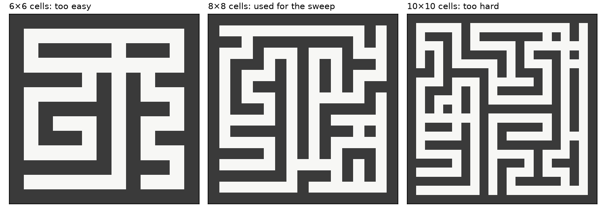
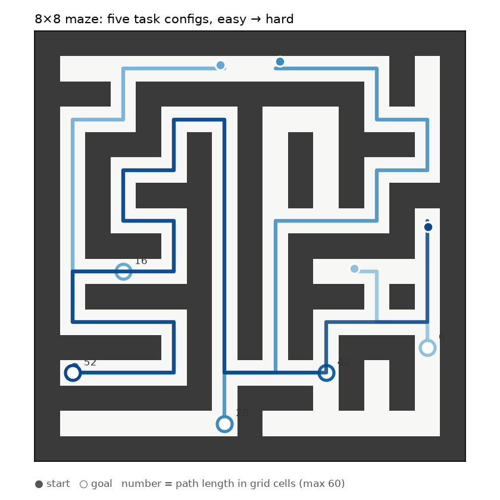
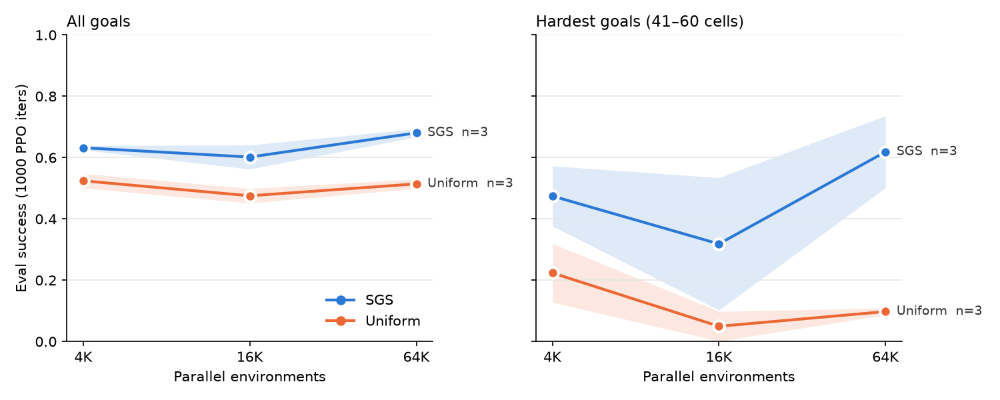
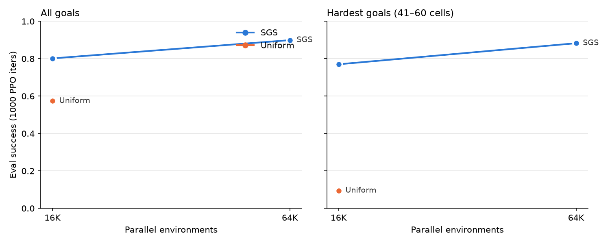
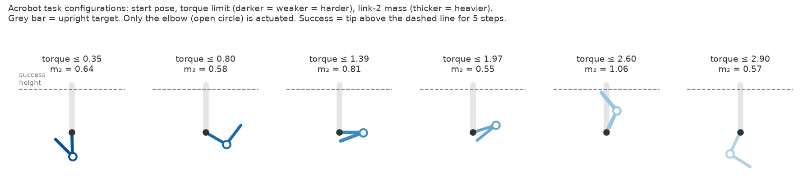
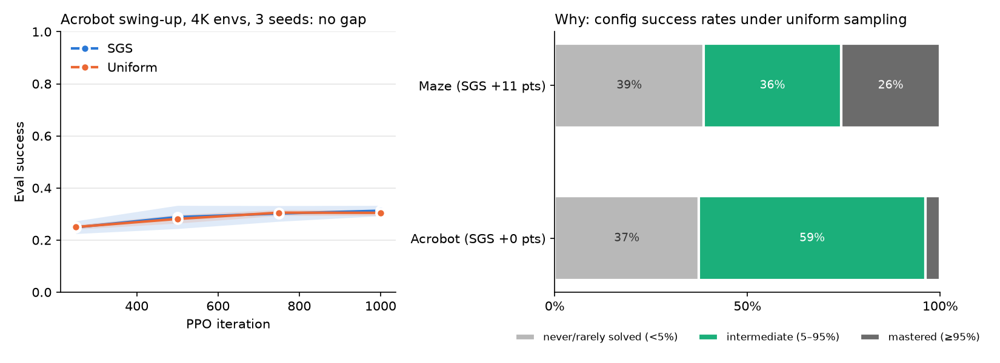
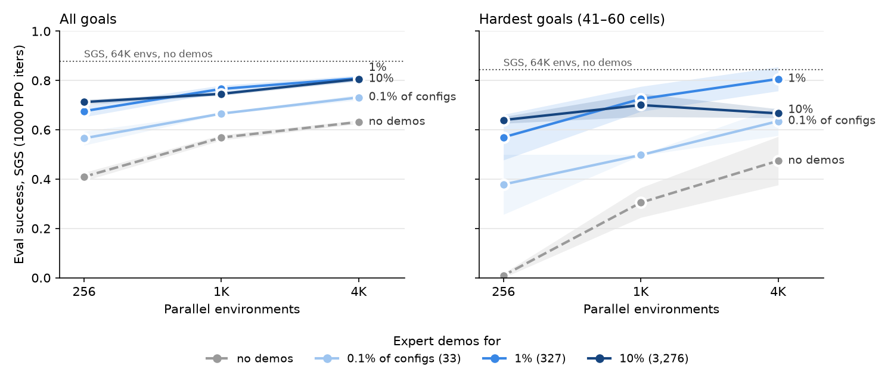

# SGS on a 2D maze: a single-GPU reproduction

This is a small reproduction of **Success Guided Sampling (SGS)** from *A Balanced Data Diet: Addressing the Exploration Bottleneck in Mega-Scale RL for Robot Control* (Zhang, Guaman Castro, Yin et al., CoRL 2026, [sgs-rl.github.io](https://sgs-rl.github.io/)).

The paper trains with up to 2²⁰ parallel environments on clusters of L40S and H200 GPUs. This repo tests the same claim with a 2D goal-conditioned maze task on one RTX 4060 Ti (16 GB). The full sweep takes about 8 GPU-hours.

## Why a maze?

This was done on a budget: one consumer GPU, no cluster, no cloud credits. The paper's own setup is far out of reach. Its locomotion runs take about 36 hours and its nut-and-bolt runs about 128 hours, each on many datacenter GPUs, using up to a million Isaac Lab environments. The best a 4060 Ti can do in Isaac Lab is a few thousand environments of one simple task, and that's well below the regime where the paper's effect appears.

The goal was to test the *idea*, not to rebuild the *robots*. SGS is only a sampler over a fixed pool of task configurations, so any task works if it has:

1. **Many configurations with very different difficulty.** Some must be trivial, some impossible at first, and some in between. That is the situation where uniform sampling wastes the batch.
2. **A sparse success signal** to compute per-configuration success rates from.
3. **Cheap enough simulation to run tens of thousands of environments in parallel**, because the paper's claim is about scaling.

The options considered:

| Option | Many envs on one GPU? | Problem |
|---|---|---|
| The paper's Isaac Lab tasks | No (a few K at most) | Can't reach the scaling regime; days per run |
| [gym-pusht](https://github.com/huggingface/gym-pusht) | No (CPU pymunk, ~1 env per core) | Can't test scaling; RL from scratch with a sparse reward may never learn |
| [Gymnasium-Robotics Fetch](https://robotics.farama.org/envs/fetch/) | No (CPU MuJoCo) | Can't test scaling; hours to days per run; reviewers expect HER as a baseline |
| **2D maze in pure PyTorch** | **Yes (64K envs fit easily)** | Simplified physics, but none of the above |

The maze meets all three requirements. Path length gives a natural difficulty range, much like the paper's terrains run from flat ground to stepping stones. Success is a single boolean. The whole environment is a few tensor operations, so 64K agents step in milliseconds on the GPU. The closest analogue in the paper is multi-terrain locomotion, where navigation over increasingly hard terrain is also the task.

## The paper's claim

The paper trains from a large, fixed set of task configurations. Uniform sampling over that set wastes more and more of each batch on configurations the policy has already mastered or can't attempt yet. As a result, adding parallel environments stops helping.

SGS tracks a running success rate *p<sub>i</sub>* for each configuration over its last *H* episodes. It then samples configurations near a target success rate *t*:

```
w_i = (p_i + ε)^(κ·t) · (1 − p_i + ε)^(κ·(1−t))
P(i) = softmax(log(w_i + ε) / T)
```

The paper reports that SGS:

- **(Q1) scales**: it keeps improving as the number of parallel environments grows, while uniform sampling and PLR level off or collapse;
- **(Q2) unlocks new capabilities**: it solves configurations the baselines can't, even at small scale.

## Mapping to this repo

| Paper | This repo |
|---|---|
| Locomotion terrains and assembly tasks (Isaac Lab) | One fixed procedural maze. A 2D point mass runs in pure-PyTorch batched simulation on the GPU. |
| Task configuration τ = (s₀, g, e) | (start position, goal cell). The pool holds N = 32,768 configurations with path length 1–60 grid cells. |
| Shared sparse reward + small regularizers | +1 on reaching the goal (within 0.5 cells), −1e-3·‖a‖² per step |
| PPO, fixed number of minibatches, batch grows with environments | Same: 32 steps per environment per iteration, 4 minibatches, 5 epochs, 1000 iterations |
| SGS locomotion hyperparameters | Same: H=100, t=0.66, κ=5, ε=1e-8, T=2 |
| Evaluation on freshly sampled configurations | 4,096 held-out configurations from the same distribution, deterministic policy |
| 4K → 1M environments | 4K → 16K → 64K environments, 3 seeds each |

**Environment details:** an 8×8-cell DFS maze on a 17×17 grid with 10% of interior walls removed. Actions are in [−1, 1]² and scaled to 0.5 cells per step. Wall collision is resolved separately on each axis. Episodes last up to 200 steps. The observation is the agent position, the goal, the vector from agent to goal, and a 5×5 patch of nearby walls.

### The mazes

Three sizes were tried. The difficulty had to be one where uniform sampling plateaus without failing completely. The 6×6 maze was too easy, and the 10×10 maze was so hard that every method stalled.



Each task configuration is a start position and a goal in the sweep maze. The pool of 32,768 configurations ranges from goals a few cells away to goals almost 60 cells away along winding corridors. The policy has to master all of them with one network. Five examples, drawn along their shortest paths:



These are the exact mazes used in the runs: `--maze-seed 0`, regenerated by `plot_maze.py`.

## Results

Final evaluation success after 1000 PPO iterations, mean ± std over 3 seeds (6 at 16K). "Hardest goals" means goals 41–60 cells away along the maze path.

| Envs | SGS, all goals | Uniform, all goals | SGS, hardest goals | Uniform, hardest goals |
|---|---|---|---|---|
| 4K  | **0.63** ± 0.01 | 0.52 ± 0.02 | **0.47** ± 0.10 | 0.22 ± 0.10 |
| 16K | **0.62** ± 0.04 | 0.49 ± 0.02 | **0.41** ± 0.21 | 0.09 ± 0.06 |
| 64K | **0.68** ± 0.01 | 0.51 ± 0.02 | **0.62** ± 0.12 | 0.10 ± 0.01 |



### What reproduced

- **SGS beats uniform at every scale.** It leads by 11–17 points overall. On the hardest goals it does 2–6× better. All 6 SGS seeds at 16K beat all 6 uniform seeds overall.
- **Uniform sampling gets nothing from scale.** Overall success stays flat at about 0.5 from 4K to 64K. Success on the hardest goals *drops* from 0.22 to about 0.1. This matches the paper's diagnosis: the minibatch count is fixed, so larger batches only average more already-solved configurations into the same number of gradient steps.
- **SGS gets the most out of the largest scale.** At 64K, SGS reaches 0.62 on the hardest goals, against 0.10 for uniform.
- **With the learning rate scaled to batch size, SGS improves steadily with scale**: 0.63 → 0.79 → 0.88 overall from 4K to 64K, and 0.47 → 0.68 → 0.84 on the hardest goals. Uniform improves only modestly overall and stays flat at about 0.2 on the hardest goals. This is the paper's main claim. See [Learning-rate scaling](#learning-rate-scaling).
- **SGS beats PLR at every scale (Q1), when PLR is given a sensible temperature.** Only SGS improves with more environments; PLR and uniform stay flat. See [PLR baseline](#plr-baseline).
- **Not specific to one maze.** SGS beats uniform by 5–12 points on each of 4 other layouts (3 seeds). See [Other maze layouts](#other-maze-layouts).
- **Robust to SGS's own settings, except temperature.** The target and concentration can vary widely and SGS still beats uniform; a temperature that's too low collapses it. See [SGS sensitivity](#sgs-sensitivity).
- **Capability at small scale (Q2).** Even at 4K, SGS solves roughly twice as many of the hardest goals as uniform. A separate single-seed run on a smaller 6×6 maze showed the same pattern: 0.46 vs 0.24 on long goals.

### What didn't (cleanly) reproduce

- **Steady improvement with scale, at a fixed learning rate.** With the learning rate fixed at 3e-4, SGS is flat from 4K to 16K and only rises at 64K. Six seeds at 16K showed the apparent dip is mostly one bad seed (hardest-goal results 0.35, **0.04**, 0.57, 0.27, 0.66, 0.57). Once the learning rate is scaled with batch size, the steady climb appears (see below), so the fixed learning rate was holding SGS back.
- **SGS has a failure mode.** About 1 seed in 6 never solves the long goals. Uniform never solves them well on any seed either.

### PLR baseline

PLR (Prioritized Level Replay) is the paper's main baseline. It's implemented here as the paper describes: levels ranked by mean |GAE|, a staleness bonus, and 50% new levels until every level has been seen. PLR's temperature β controls how strongly it favours the top-ranked levels.

| Envs | SGS | **PLR β=1** | Uniform | PLR β=0.1 |
|---|---|---|---|---|
| *All goals* | | | | |
| 4K | **0.63** ± 0.01 | 0.58 ± 0.03 | 0.52 ± 0.02 | 0.22 |
| 16K | **0.62** ± 0.04 | 0.57 ± 0.05 | 0.49 ± 0.02 | 0.22 |
| 64K | **0.68** ± 0.01 | 0.57 ± 0.05 | 0.51 ± 0.02 | 0.21 |
| *Hardest goals* | | | | |
| 4K | **0.47** ± 0.10 | 0.33 ± 0.05 | 0.22 ± 0.10 | 0.00 |
| 16K | **0.41** ± 0.21 | 0.31 ± 0.12 | 0.09 ± 0.06 | 0.00 |
| 64K | **0.62** ± 0.12 | 0.36 ± 0.03 | 0.10 ± 0.01 | 0.00 |

Seeds: PLR β=1 has 3 per point; PLR β=0.1 has 2, 2 and 1 (cancelled early).

**With a sensible temperature (β=1), PLR is a strong baseline.** It beats uniform at every scale, and on the hardest goals by 3–4×. **SGS still beats PLR at every scale, and only SGS improves with more environments.** PLR stays flat at 0.57 overall from 4K to 64K, while SGS rises to 0.68, and to 0.62 vs 0.36 on the hardest goals. That is the paper's Q1 claim ("SGS scales better than uniform *and PLR*"), reproduced in miniature.

**The default PLR temperature (β=0.1) breaks at this scale.**

With β=0.1, PLR does **much worse than uniform**. This comes from the default setting, not a code bug. PLR weights configs by rank^(−1/β) = rank^(−10). With 32,768 configs that sends **about 90% of all resets to the single highest-scoring config**, so each batch of 4K+ environments is nearly one task. PLR's defaults were tuned for about 64 environments. The paper doesn't say which PLR settings it used, but its PLR roughly matches uniform on most tasks, so it can't have been this degenerate. With β=1, about 8% of resets go to the top config. That's the fair comparison above.

### Learning-rate scaling

The main sweep keeps the learning rate at 3e-4 while the batch grows 16×, so larger runs take the same number of equally sized gradient steps on much bigger batches. Does that hide the benefit of scale? Here the learning rate grows with the square root of the batch size: 3e-4 at 4K (unchanged), 6e-4 at 16K, and 1.2e-3 at 64K. 3 seeds each.

| Envs | SGS, all goals | Uniform, all goals | SGS, hardest goals | Uniform, hardest goals |
|---|---|---|---|---|
| 4K | 0.63 ± 0.01 | 0.52 ± 0.02 | 0.47 ± 0.10 | 0.22 ± 0.10 |
| 16K | **0.79** ± 0.02 | 0.59 ± 0.08 | **0.68** ± 0.10 | 0.19 ± 0.14 |
| 64K | **0.88** ± 0.05 | 0.65 ± 0.04 | **0.84** ± 0.08 | 0.22 ± 0.10 |



- **Scaling the learning rate turns SGS's curve into a steady climb.** Overall success rises from 0.63 at 4K to 0.88 at 64K; on the hardest goals it rises from 0.47 to 0.84.
- **Uniform gains about 13 points overall, but none on the hardest goals.** It stays around 0.2, so the extra data goes to configs it can already solve.
- **The gap widens with scale:** 11 points at 4K, 20 at 16K, 23 at 64K overall, and from 0.25 to 0.62 on the hardest goals. A larger learning rate makes better use of a large batch only when the batch is full of useful configs, which is what SGS provides.

### Other maze layouts

Is the result specific to one maze? Here are four more 8×8 layouts (`--maze-seed 1..4`), 4K envs. SGS and uniform have 3 seeds each; PLR has 1. The original layout is maze 0.

| Maze | SGS, all goals | Uniform, all goals | PLR β=1, all goals | SGS, hardest | Uniform, hardest | PLR β=1, hardest |
|---|---|---|---|---|---|---|
| 0 (3 seeds) | **0.63** | 0.52 | 0.58 | **0.47** | 0.22 | 0.33 |
| 1 | **0.46** ± 0.04 | 0.41 ± 0.02 | 0.32 | **0.10** ± 0.07 | 0.04 ± 0.03 | 0.00 |
| 2 | **0.53** ± 0.05 | 0.46 ± 0.02 | 0.38 | **0.16** ± 0.10 | 0.04 ± 0.01 | 0.00 |
| 3 | **0.44** ± 0.01 | 0.32 ± 0.03 | 0.36 | 0.02 ± 0.02 | 0.00 | 0.00 |
| 4 | **0.60** ± 0.02 | 0.48 ± 0.03 | 0.47 | **0.07** ± 0.01 | 0.01 ± 0.01 | 0.04 |

**SGS beats uniform on every layout, by 5–12 points.** With 1 seed the gap looked like a uniform 12–13 points; with 3 seeds it varies by layout, but it's positive everywhere. PLR (β=1) is less robust: it beat uniform on maze 0 but loses to it on mazes 1 and 2, ties on maze 4, and wins only on maze 3. The new layouts are harder than maze 0 for every method, and the hardest goals stay mostly out of reach at 4K.

### SGS sensitivity

The paper reports that SGS isn't sensitive to most of its settings. Here each setting is changed one at a time from the defaults used everywhere else (target t=0.66, concentration κ=5, temperature T=2). Maze, 4K envs, 2 seeds each.

| Setting | All goals | Hardest goals |
|---|---|---|
| Default (t=0.66, κ=5, T=2) | 0.63 ± 0.01 | 0.52 ± 0.10 |
| t = 0.3 | **0.69** ± 0.02 | 0.51 ± 0.05 |
| t = 0.5 | 0.67 ± 0.02 | 0.47 ± 0.02 |
| t = 0.8 | 0.60 ± 0.03 | 0.45 ± 0.08 |
| κ = 1 | 0.63 ± 0.02 | 0.44 ± 0.06 |
| κ = 20 | 0.64 ± 0.01 | 0.50 ± 0.10 |
| T = 8 (flatter) | 0.60 ± 0.00 | 0.31 ± 0.03 |
| **T = 0.5 (greedier)** | **0.19** ± 0.00 | **0.00** |
| *Uniform, for reference* | *0.52 ± 0.03* | *0.20 ± 0.11* |

- **The target and concentration barely matter.** Every value of t from 0.3 to 0.8 and κ from 1 to 20 gives 0.60–0.69 overall, all well above uniform. A lower target (t=0.3, favouring harder configs) was slightly better here.
- **Temperature is the one setting that can break SGS.** At T=0.5 the softmax becomes so peaked that the batch collapses onto a few configs, and success falls to 0.19, far *below* uniform. This is the same failure as PLR with β=0.1. A flatter T=8 behaves more like uniform sampling and loses about half the hardest-goal gain.

### Acrobot: a negative control

To see whether the effect carries over to classical control, the same code also runs a torque-limited **Acrobot swing-up** (`--task acrobot`, in [acrobot.py](acrobot.py)). It's a two-link pendulum where only the elbow is actuated. A task configuration is (initial angles and velocities, torque limit 0.25–3, link-2 mass 0.5–1.5). Success means holding the tip above height 1.8 (out of a maximum of 2.0) for 5 steps, which means swinging up and nearly balancing. The dynamics follow Sutton & Barto with RK4 integration, and the selftest checks energy conservation.



Calibration (4K envs, 300 iterations, 1 seed) to find a difficulty where learning happens without saturating:

| Success criterion | SGS | Uniform |
|---|---|---|
| Tip above 1.8, held 10 steps | 0.09 | 0.08 |
| Above 1.7, held 10, torque from 0.25 | 0.15 | 0.14 |
| **Above 1.8, held 5, torque from 0.25** | 0.27 | 0.25 |
| Above 1.5, held 5 | 0.75 | 0.71 |
| Cross 1.0 once (Gymnasium-style) | 0.93 | 0.93 |

Final setting (bold row), 1000 iterations, 3 seeds:

| | All configs | Lowest torque (0.25–1) | Highest torque (2–3) | Configs at 5–95% success |
|---|---|---|---|---|
| SGS | 0.31 ± 0.02 | 0.14 ± 0.01 | 0.44 ± 0.03 | 3–4% |
| Uniform | 0.31 ± 0.01 | 0.14 ± 0.02 | 0.41 ± 0.03 | **57–61%** |
| SGS, κ=1, t=0.5 (1 seed) | 0.30 | 0.13 | 0.44 | 46% |



**No meaningful SGS advantage on Acrobot.** The last column of the table, and the right panel above, suggest why. Under uniform sampling, about 60% of Acrobot configs already sit at intermediate success. So uniform sampling isn't wasting the batch on solved or impossible configs, and SGS has nothing to fix. In the maze, 65% of configs under uniform sampling are either never solved or already mastered. That's the waste SGS removes. In Acrobot it's 41%, and most of the rest are configs the policy already learns from.

Two likely reasons, neither proven:
1. One skill, pumping energy and then balancing, transfers across all Acrobot configs, while each maze goal needs its own route.
2. Acrobot success depends more on policy noise than on the config, which makes per-config success rates a weak signal.

The working conclusion is that SGS helps when competence is config-specific and difficulty is very uneven, which is the situation the paper describes.

### Prior knowledge: can demos or smarter resets replace environments?

The paper deliberately avoids demonstrations and shaped rewards. This section asks the opposite question: what is a little prior knowledge worth, measured in environments? All runs use 1000 iterations and 3 seeds. Run them with `./priors.sh`.

**Maze: expert demos plus behaviour cloning (DAPG-style).** A BFS expert, which heads for the next cell centre on a shortest path and solves 100% of configs, demonstrates **1% of the config pool**: 327 episodes, about 12.6K state-action pairs. PPO gets an extra behaviour-cloning loss on those demos, `‖π(s) − a_expert‖²`, with a weight of 1.0 that halves about every 140 iterations (`--demo-frac 0.01`).

| Setting | All goals | Hardest goals |
|---|---|---|
| Uniform, 4K | 0.52 ± 0.02 | 0.22 ± 0.10 |
| **Uniform + demos, 4K** | **0.80** ± 0.02 | **0.61** ± 0.11 |
| SGS, 1K | 0.57 ± 0.01 | 0.31 ± 0.06 |
| **SGS + demos, 1K** | **0.77** ± 0.02 | **0.73** ± 0.05 |
| SGS, 4K | 0.63 ± 0.01 | 0.47 ± 0.10 |
| **SGS + demos, 4K** | **0.81** ± 0.01 | **0.81** ± 0.05 |
| SGS, 64K (fixed LR) | 0.68 ± 0.01 | 0.62 ± 0.12 |
| SGS, 64K (scaled LR) | 0.88 ± 0.05 | 0.84 ± 0.08 |

- **Demos on 1% of configs are worth roughly 16× the environments.** SGS + demos at 4K nearly matches SGS at 64K with a scaled learning rate on the hardest goals (0.81 vs 0.84), and comes within 7 points overall (0.81 vs 0.88). At **1K** environments, SGS + demos (0.77) already beats SGS at 64K with a fixed learning rate (0.68), a 64× smaller run.
- **Demos mostly close the SGS–uniform gap overall** (0.81 vs 0.80), but SGS keeps a clear edge on the hardest goals (0.81 vs 0.61). The demos supply the exploration that SGS was providing, but SGS still steers practice toward the long goals.
- Caveat: a perfect expert is cheap here because the maze is fully known. With real robots, demos come from teleoperation and are imperfect, so 1% of configs is a small but not free budget. The next two experiments test smaller demo budgets and noisy experts.

**How much demo data, at how many environments?** SGS with demos for 0.1%, 1% or 10% of the pool, at 256, 1K and 4K environments (2–3 seeds each, `./cheap.sh`):

| Envs | No demos | 0.1% (33 configs) | 1% (327) | 10% (3,276) |
|---|---|---|---|---|
| *All goals* | | | | |
| 256 | 0.41 | 0.57 | 0.68 | **0.71** |
| 1K | 0.57 | 0.67 | **0.77** | 0.75 |
| 4K | 0.63 | 0.73 | **0.81** | **0.81** |
| *Hardest goals* | | | | |
| 256 | 0.01 | 0.38 | 0.57 | **0.64** |
| 1K | 0.31 | 0.50 | **0.73** | 0.70 |
| 4K | 0.47 | 0.64 | **0.81** | 0.67 |



- **256 environments with 1% demos (0.68) beat 4K environments with none (0.63)**, a 16× smaller run. On the hardest goals, demos take 256 envs from 0.01 to 0.57.
- **Even 33 demonstrated configs (0.1%) help a lot:** +10 to +16 points overall at every scale.
- **More demos isn't always better.** 10% helps most at 256 envs, matches 1% overall at 1K and 4K, and does worse on the hardest goals at 4K (0.67 vs 0.81, 2 seeds). A plausible reason is that a large behaviour-cloning set pulls the policy toward imitation for longer; with more envs, PPO's own experience matters more.

**Noisy experts.** Each recorded expert action is replaced by a uniformly random one with probability p, mimicking a sloppy teleoperator (1% demos, 4K, 2 seeds; `--demo-noise`):

| Expert | All goals | Hardest goals |
|---|---|---|
| Perfect | 0.81 | 0.81 |
| 20% random actions | 0.81 | 0.78 |
| 50% random actions | 0.74 | 0.56 ± 0.20 |
| *No demos* | *0.63* | *0.47* |

- **20% noise costs essentially nothing.** Random actions in the labels average out in a squared-error loss.
- **Even with half the actions random, demos still beat no demos** (0.74 vs 0.63), though the hardest goals become seed-dependent.

**Acrobot: demo-style resets without an expert.** Acrobot has no expert, so "demonstrations" are generated by simulating the dynamics **backward in time from upright** under random elbow torques within each config's limit. A state k steps back can reach upright in k steps by construction; the selftest checks that integrating backward and then forward returns to the start. Half the training pool is replaced by such starts, with k from 1 to 200 (`--reverse-frac 0.5`). Evaluation stays on the original start distribution.

| Setting | All configs | Lowest torque (0.25–1) |
|---|---|---|
| Uniform | 0.31 ± 0.01 | 0.14 ± 0.02 |
| **Uniform + reverse resets** | **0.37** ± 0.02 | **0.17** ± 0.01 |
| SGS | 0.31 ± 0.02 | 0.14 ± 0.01 |
| SGS + reverse resets | 0.28 ± 0.04 | 0.14 ± 0.02 |

- **Reverse resets help uniform by 6 points**, with low variance. Practising near-upright states teaches the balancing phase, which every swing-up has to end with.
- **They don't help SGS, and slightly hurt it.**

**Why not? Diagnosis (3 seeds, `./cheap.sh`).** Logging which part of the pool SGS draws from confirms that SGS is pulled toward the reverse starts:

| Iteration | Share of SGS resets from reverse starts | Success rate, reverse starts | Success rate, original starts |
|---|---|---|---|
| 250 | 67–70% | 0.73 | 0.13 |
| 500 | 62–63% | 0.75 | 0.15 |
| 1000 | 54–57% | 0.78 | 0.18 |

But forcing a fixed 50/50 split, with SGS choosing only *within* each half (`--reverse-split`), **doesn't fix it**: 0.27 ± 0.02, no better than unsplit SGS (0.28) and still below uniform with reverse resets (0.37). So the batch share alone doesn't explain it. A remaining hypothesis: within the reverse half, SGS avoids the starts it has already mastered (p ≈ 1). Those are the near-upright, small-k starts that teach balancing, so SGS gets *less* balancing practice than uniform. Within the original half, SGS concentrates on a narrow set of mid-success configs, and Acrobot's evaluation needs broad coverage. This hasn't been tested.

### Not tested

- **SFL baseline, and hand-designed curricula.**
- **Real-robot transfer and DAgger distillation from the paper.** These are out of scope.

### Earlier exploratory runs

All single-seed. Logs are in `*.log`, results in `runs_*/`.

| Setting | SGS | Uniform | Note |
|---|---|---|---|
| 10×10 maze, max path 80, 4K envs | 0.26 | 0.20 | Too hard: every method stalls and goals beyond 40 cells are about 0% |
| 10×10 maze, 16K envs | 0.22 | 0.20 | More environments helped neither method |
| 10×10, SGS with κ=1, t=0.5, ε=1e-4 (paper's manipulation values) | 0.23 | – | Slightly worse than κ=5 here |
| 6×6 maze, max path 40, 4K envs | 0.78 | 0.70 | Easy regime |
| 8×8 maze, max path 60, 4K envs, 600 iters | 0.56 | 0.47 | Calibration run for the sweep |

The 8×8 maze was chosen so that uniform sampling plateaus around 50% instead of failing outright. A gap between the two methods only shows up in that kind of regime.

## Next steps

**Nothing is running.** The last queue, [next3.sh](next3.sh), has finished (logs in `next.log`):

| # | Experiment | Why | Est. GPU time | Status |
|---|---|---|---|---|
| 1 | **PLR with β=1.0**, 4K/16K/64K × 3 seeds | Fair version of the paper's main baseline (see above) | ~4 h | **Done** |
| 2 | **4 more maze layouts** (`--maze-seed 1..4`) × {SGS, uniform, PLR β=1}, 4K | Check that the result isn't specific to one maze | ~1 h | **Done** |
| 3 | **Learning rate scaled with batch size** (√ rule: 6e-4 at 16K, 1.2e-3 at 64K) × {SGS, uniform} × 3 seeds | Rule out that uniform's flat curve is a fixed-LR artifact | ~7.5 h | **Done** (paused once for the prior-knowledge runs) |
| 4 | **128K environments** × {SGS, uniform} × 3 seeds | One more step on the scaling curve | ~12 h | **Cancelled** (too many GPU-hours) |

Afterwards, possibly: **FetchPush** (Gymnasium-Robotics) with SGS vs uniform vs HER, as a real manipulation task. That one is CPU-bound and would take days.

**Also done:** 3 more seeds at 16K (resolved the dip); PLR at β=0.1 (degenerate); Acrobot (negative control); prior-knowledge experiments (maze demos, Acrobot reverse resets); SGS sensitivity; demo-value curve and noisy experts; Acrobot sampling diagnosis; more seeds on other maze layouts. See above for each.

**Open ideas:**

- **Why SGS doesn't benefit from Acrobot reverse resets.** The batch-share explanation was ruled out (see above). The next test: log success by k (steps back from upright) and see whether SGS skips the near-upright starts.
- **Hindsight Experience Replay (HER)** (Andrychowicz et al. 2017). After a failed episode, relabel the goal as wherever the agent actually ended up, so every episode yields a success for *some* goal. SGS changes *which* tasks get practised; HER changes *what is learned* from each episode, so the two could complement each other. HER needs an off-policy learner (SAC or DDPG) instead of PPO. The maze suits it well, since the "achieved goal" is just the final position. It's also the standard baseline needed for the FetchPush idea above.
- **SGS + demos across scales:** do demos flatten SGS's scaling curve, or does the combination keep improving with more environments?
- **A dynamic task with very uneven difficulty,** e.g. a point mass with inertia jumping gaps of varying width. This is closer to the paper's hard terrains than Acrobot, where every config needed the same skill.

`plot.py` reads `runs_sweep/` and `runs_plr_b1/` by default and picks up new JSON files automatically. `plot.py runs_lr runs_sweep --only sgs,uniform` draws the learning-rate comparison.

## Running it

```bash
uv venv .venv --python 3.12
uv pip install --python .venv/bin/python torch --index-url https://download.pytorch.org/whl/cu128  # match your driver
uv pip install --python .venv/bin/python numpy matplotlib

.venv/bin/python sgs_maze.py --selftest                       # maze, collisions, sampler, PLR, acrobot energy conservation
.venv/bin/python sgs_maze.py --sampler sgs --num-envs 4096 --cells 8 --max-dist 60   # --sampler sgs|uniform|plr
.venv/bin/python sgs_maze.py --task acrobot --sampler sgs --horizon 400 --height 1.8 --hold 5 --tau-min 0.25 --out runs_acro
./sweep.sh                                                    # full sweep, resumable, logs to sweep.log
.venv/bin/python plot.py                                      # runs_sweep/scaling.png + summary table
```

## GPU budget

Everything here used **about 31 hours of one RTX 4060 Ti**:

| Phase | Runs | GPU wall-clock |
|---|---|---|
| Exploration (maze sizes, SGS settings, calibration) | 9 | ~1 h (2–3 runs shared the GPU at a time) |
| Scaling sweep (3 seeds × 3 scales × 2 samplers) | 18 | 7.9 h (one run at a time) |
| 3 more seeds at 16K | 6 | 1.6 h |
| PLR β=0.1 (cancelled after 5 runs) | 5 | ~1.9 h |
| Acrobot calibration and seeds | 17 | ~0.8 h (2–4 runs shared the GPU at a time) |
| PLR β=1 | 9 | 4.0 h |
| Other maze layouts | 12 | 1.0 h |
| Learning-rate scaling | 12 | ~7.4 h (excluding the pause) |
| Prior knowledge (maze demos, Acrobot reverse resets) | 18 | 1.2 h (3 runs at a time) |
| Sensitivity, demo curve, noisy demos, Acrobot diagnosis, layout seeds | 56 | 3.7 h (4 runs at a time) |
| **Total** | **162** | **~31 h** |

The 128K-environment runs (~12 h) were cancelled to save GPU time.

Time per 1000-iteration run with the GPU to itself:

| Parallel envs | Time per run | Env steps per run |
|---|---|---|
| 4K | ~5 min | 131 M |
| 16K | ~15 min | 524 M |
| 64K | ~60 min | 2.1 B |

Training uses about 0.7 GB of GPU memory at 4K environments and about 8 GB at 64K. So 128K would be close to the 16 GB limit and might need more minibatches (`--num-minibatches`). For comparison, a *single* locomotion run in the paper takes about 36 hours on multiple datacenter GPUs.

## Files

| File | Contents |
|---|---|
| `sgs_maze.py` | Maze generator, GPU environment, SGS / uniform / PLR samplers, PPO, evaluation, self-test; `--task maze\|acrobot` |
| `acrobot.py` | GPU-batched torque-limited Acrobot swing-up (RK4) with its energy-conservation self-test |
| `sweep.sh` | 3 seeds × {4K, 16K, 64K} × {SGS, uniform} |
| `priors.sh` | Prior-knowledge runs: maze demos (4K, 1K) and Acrobot reverse resets |
| `cheap.sh` | SGS sensitivity, demo-value curve, noisy demos, Acrobot sampling diagnosis, more layout seeds |
| `plot_demos.py` | Demo-value curve: `demos_curve.png` |
| `next1.sh`, `next2.sh`, `next3.sh` | Follow-up queues: extra 16K seeds; PLR β=0.1 (cancelled); PLR β=1, mazes, LR scaling, 128K |
| `plot.py` | Scaling plot and summary from `runs_sweep/*.json` |
| `plot_maze.py` | Maze pictures: `maze_sizes.png`, `maze_configs.png` |
| `plot_acrobot.py` | Acrobot pictures: `acrobot_configs.png`, `acrobot_results.png` |
| `runs_sweep/` | Per-run JSON logs (evaluation curves, success by distance, fraction of mastered configs) |
| `runs_acro_*/`, `runs_plr_b1/`, `runs_mazes/`, `runs_lr/` | Acrobot, PLR β=1, other mazes, LR scaling |

## Implementation notes

- If several environments finish the same configuration in one step, each outcome gets its own slot in that configuration's ring buffer, so no outcome is lost.
- Timeouts are treated as terminal states, with no bootstrapping. The observation has no time feature, so the value function couldn't use one anyway.
- PLR scores each config by the mean |GAE| of its steps in the latest 32-step rollout, rather than over a whole episode. This is a shortcut, since episodes span several rollouts.
- Configurations that have never been visited have *p* = 0, so SGS samples them rarely once some configurations start succeeding. This is the paper's intended behaviour: the ε floor keeps every configuration's probability above zero.
