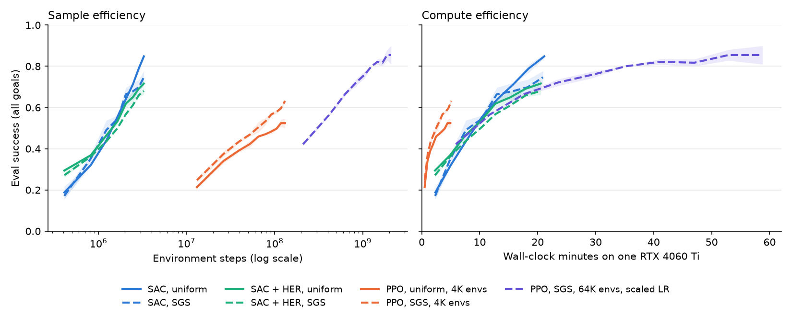

# SAC + Hindsight Experience Replay on the SGS maze

> **Update:** the headline result here, that plain SAC beats PPO + SGS with about 600× fewer steps, **did not transfer** to a standard benchmark. On MuJoCo Playground's PandaPickCube, both standard Brax PPO and Brax SAC reach about 98–99% success. SAC needs only about 1.3× fewer environment steps, and PPO is about 8× faster in wall-clock (15 minutes vs 2 hours). See [../playground/README.md](../playground/README.md).

A side experiment to [the SGS reproduction](../README.md). It runs on the same maze, configuration pool, evaluation set and success rule, so its numbers compare directly with the PPO runs there.

**The question:** SGS fixes sparse rewards by choosing *which tasks to practise*. Hindsight Experience Replay (HER; Andrychowicz et al. 2017) fixes them by changing *what is learned from each episode*: a failed episode is also stored as a success for the goal the agent actually reached. HER needs an off-policy learner, so this uses SAC instead of PPO. Does HER help, does SGS still help an off-policy learner, and do the two stack?

## Setup

- **SAC**: tanh-squashed Gaussian policy, twin critics with target networks, automatic entropy tuning. Networks are 3×256 ELU MLPs, as in the PPO runs.
- **HER "future" relabelling** with probability 0.8: the goal is replaced by a position the agent reached later in the same episode. The goal entries of the observation are rewritten, and reward and termination are recomputed with the environment's own success rule. The replay buffer stores whole episodes on the GPU so future positions are available.
- **Settings:** 256 parallel envs, 8 gradient updates per environment step, batch 4096, 3.3M environment steps per run (about 21 minutes), 2 seeds. Config sampling at reset is uniform or SGS (the paper's locomotion values, as in the PPO runs).
- **One essential fix:** SAC's entropy weight α must start small (0.01). At the usual 1.0, the bonus for acting randomly outweighs the rare +1 success reward about 100× over the effective horizon, and the policy learns nothing (0% after 13M steps).

```bash
.venv/bin/python her/sac_her.py --selftest     # relabelling round-trip; HER turns random-walk data into successes
./her/run_her.sh                               # the full experiment (~2 h with 2 runs in parallel)
.venv/bin/python her/plot_her.py               # her/sac_vs_ppo.png
```

## Results

**Main pool (all goals, 1–60 cells), 3.3M environment steps:**

| Learner | All goals | Hardest goals (41–60) |
|---|---|---|
| **SAC, uniform** | **0.85** ± 0.01 | **0.56** ± 0.10 |
| SAC, SGS | 0.75 ± 0.03 | 0.34 ± 0.08 |
| SAC + HER, uniform | 0.72 ± 0.02 | 0.30 ± 0.07 |
| SAC + HER, SGS | 0.68 ± 0.02 | 0.23 ± 0.06 |
| *PPO, SGS, 4K envs (131M steps)* | *0.63* | *0.47* |
| *PPO, SGS, 64K envs, scaled LR (2.1B steps)* | *0.88* | *0.84* |

**Hard goals only (41–52 cells, training and evaluation), 3.3M environment steps:**

| Learner | Success |
|---|---|
| SAC | 0.00 |
| SAC + HER | 0.05 ± 0.02 |



### What this shows

- **Plain SAC is the surprise winner.** It reaches 0.85 in 3.3M environment steps and 21 minutes. PPO + SGS needs about 2B steps and about 50 minutes at 64K environments to get there. That's roughly **600× fewer environment steps** and well under half the wall-clock. The SAC curves are still rising at the end, so the gap may grow. On the hardest goals PPO at 64K is still ahead (0.84 vs 0.56).
- **HER hurts when the task pool already contains easy goals** (0.72 vs 0.85). HER's early learning is faster (0.29 vs 0.19 at the first evaluation), but 80% of training goals become relabelled positions that are mostly a few cells away. That crowds out the real long-range goals. HER was designed for tasks where real successes are almost nonexistent; here the pool's short goals already provide them.
- **When successes really are rare, HER is the only thing that gets any signal.** With hard goals only, plain SAC never succeeds (0.00), while SAC + HER reaches 0.05. That's small, but it's the expected direction. A longer run or a mixed curriculum would be needed to make it useful.
- **SGS hurts SAC** (0.75 vs 0.85), the opposite of PPO. A likely reason: SAC learns from a replay buffer of everything collected so far, so it never "wastes the batch" the way PPO does. SGS only narrows which episodes go into the buffer, reducing its diversity. The SGS settings were also tuned for PPO.
- **HER + SGS is the worst combination** (0.68): both shift training away from the real distribution of goals.

### Caveats

- Two seeds per arm, one maze layout, one length of run.
- SAC got one tuning fix (the starting α); PPO's settings were never tuned for this maze either.
- The relabelling probability (0.8) is HER's standard value for robot arms; lower values might suit a pool that already contains easy goals.
- Wall-clock comparisons depend on implementation details, such as how many gradient updates run per environment step.

## Files

| File | Contents |
|---|---|
| `sac_her.py` | SAC, episode replay buffer on the GPU, HER relabelling, self-test. Imports the maze, sampler and evaluation from `../sgs_maze.py`. |
| `run_her.sh` | The experiment: 4 main arms + 2 hard-pool arms × 2 seeds. Resumable. |
| `plot_her.py` | `sac_vs_ppo.png`: SAC and PPO by environment steps and by wall-clock. |
| `runs/main/`, `runs/hard/` | Per-run JSON logs. |
