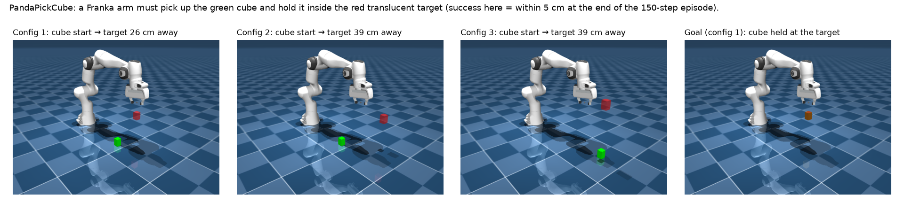
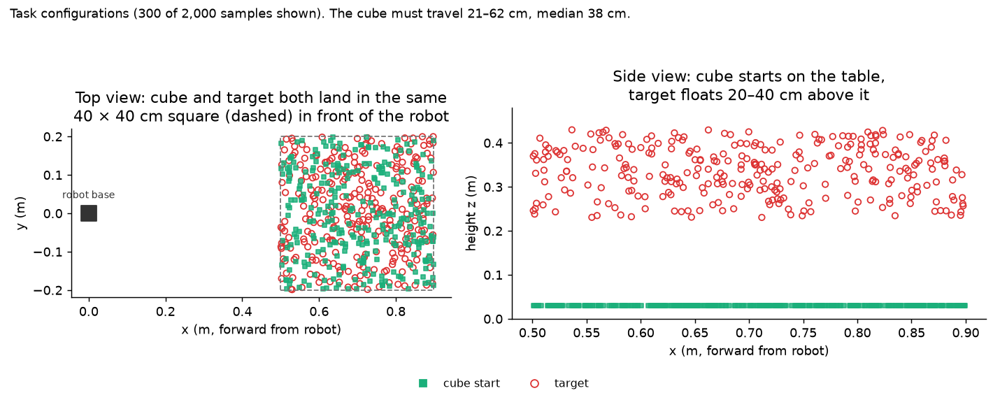
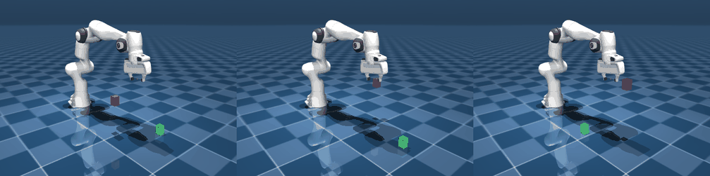
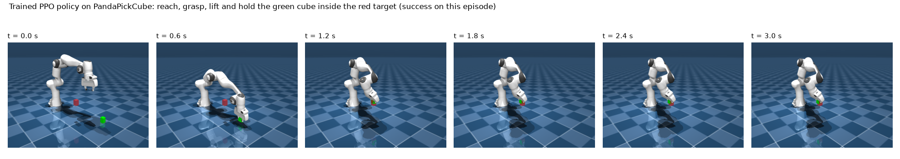
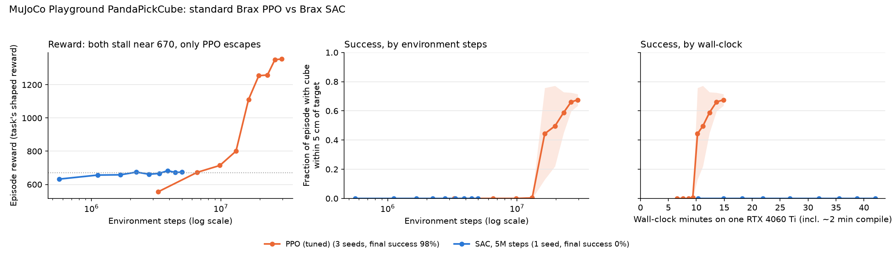

# Does "SAC beats PPO" survive outside the maze?

On the [2D maze](../README.md#off-policy-learning-sac-and-hindsight-experience-replay), plain SAC matched the best PPO + SGS result with about 600× fewer environment steps ([details](../her/README.md)). Before trying that on the SGS paper's own robot tasks, this checks it on a **standard GPU benchmark** with **standard implementations**: Brax PPO vs Brax SAC on MuJoCo Playground's `PandaPickCube`.

**Short answer: no, not the 600× part.** Both methods solve PandaPickCube (about 98–99% success). SAC needs slightly fewer environment steps, about 1.3× fewer to escape the hardest part, but PPO gets there about **8–15× faster in wall-clock** (8–17 minutes against about 2 hours).

## The task

A Franka Panda arm has to pick up a small green cube (4 × 4 × 6 cm) from the table and hold it inside a red, translucent target floating in the air. Each episode is 150 control steps, 3 seconds at 50 Hz. The arm is controlled by small joint-position changes, 8 numbers per step: 7 joints plus the gripper.



Every episode samples a new **task configuration**: the cube starts at a random spot in a 40 × 40 cm square on the table, and the target is placed somewhere above the same square, 20–40 cm up. So the cube has to be grasped and carried 21–62 cm (median 38 cm), usually mostly upward.



The policy has to learn a whole sequence: reach the cube, close the gripper on it, lift without dropping it, carry it to the target, and hold it there. The reward plateau in the results below most likely corresponds to getting stuck after the first step (reaching the cube without lifting it); that reading comes from how the reward is built, not from watching rollouts.

### A trained policy doing it

A PPO policy trained with Playground's tuned settings, on three random configurations (all three succeed; real-time speed):





It reaches the cube within about 0.6 s, lifts it into the target by about 1.2 s, and holds it there for the rest of the 3-second episode. The cube is often hidden behind the gripper once it's grasped. This policy reached 99.2% success over 1024 evaluation episodes after **8.4 minutes** of training with the GPU to itself. It was retrained with `--save-rollout 3` (see `make_video.sh`); the weights are in `runs_video/ppo_s0.params`.

## Setup

- **Task:** [MuJoCo Playground](https://github.com/google-deepmind/mujoco_playground) `PandaPickCube`. A Franka Panda arm must pick up a cube from a random spot on the table and hold it at a random 3D target, with 150 steps per episode. The task's own shaped reward is used unchanged.
- **Success** isn't defined by the task, so it's added here: the cube within 5 cm of the target at the episode's last step, over 1024 fresh episodes with a deterministic policy. During training, Brax's evaluator also logs the number of steps per episode with the cube within 5 cm.
- **PPO:** Brax PPO with **Playground's tuned settings** for this task (2048 envs, about 30M steps with these evaluation settings).
- **SAC:** Brax SAC with **Playground's tuned SAC settings** from its DM Control tasks (128 envs, 8 gradient updates per step, batch 512, learning rate 1e-3, layer-norm critics), with the same discount as PPO (0.97). There are no tuned SAC settings for manipulation.
- **Neither side uses code written for this repo**, apart from the success metric.

**Environment notes:** JAX 0.8.2, Brax 0.14.2, MuJoCo/MJX 3.15.0, Playground 0.2.0. JAX had to be pinned to 0.8.2 because the newest JAX removed a function Brax still uses. The physics runs on the classic **MJX (JAX) backend**: Playground's default MuJoCo Warp backend needs CUDA driver 13, and this machine has 12.8. PPO's settings were tuned on Warp, but they clearly still work.

```bash
uv venv .venv --python 3.12 && uv pip install --python .venv/bin/python "jax[cuda12]==0.8.2" playground
.venv/bin/python brax_compare.py --algo ppo --seed 0 --num-evals 10
.venv/bin/python brax_compare.py --algo sac --seed 0 --steps 5000000 --num-evals 10
../.venv/bin/python plot_stage_a.py          # stage_a.png (uses the main venv's matplotlib)
```

## Results

| PandaPickCube | Seeds | Env steps | Wall-clock | Success at episode end |
|---|---|---|---|---|
| **PPO (tuned)** | 3 | ~30M | 14–17 min | **98%** (0.981, 0.964, 0.992) |
| SAC, short run | 1 | 5M | 42 min | 0% |
| **SAC, long run** | 1 | 20M | 123 min | **99%** (0.989) |



- **Both methods hit the same reward plateau, about 670.** In this reward that roughly means reaching the cube without lifting it to the target.
- **SAC reaches the plateau about 10× sooner** (about 0.6M steps against about 6M for PPO), then sits on it for about 9M steps.
- **Both escape it, SAC slightly first in environment steps:** SAC at about 10–11.6M steps, PPO at about 13–16M steps on all 3 seeds. After escaping, SAC ends slightly higher (reward 1445 vs about 1350; 114 vs about 101 of 150 steps within 5 cm).
- **Final success is the same:** 99% for SAC, 98% for PPO.
- **Per wall-clock, PPO wins by about 8×.** On this GPU, PPO collects about 150K environment steps per second; SAC, with 8 gradient updates per step, manages about 2.7K. So PPO escapes the plateau after about 10 minutes, SAC after about 70.
- **The earlier "SAC is at 0%" (5M-step run) was simply too short.** It stopped about 5M steps before SAC's escape.

**Why the maze's 600× didn't transfer (likely):** the maze is short-horizon, and its pool of easy goals feeds a steady stream of successes, so SAC's sample reuse pays off immediately. Here the hard part is one exploration step, lifting the cube. Both methods need about 10M+ steps of trying before it clicks, and sample reuse doesn't shorten that much. Once environment steps are cheap (GPU physics), the method that turns GPU time into environment steps fastest wins on wall-clock, and that's PPO.

## Caveats

- SAC has one seed, and its settings are tuned for locomotion, not manipulation. A manipulation-tuned SAC, or a modern parallel off-policy method such as FastTD3/FastSAC, might do much better.
- SAC has one seed for each run length. Its escape point (about 10–11.6M steps) may vary across seeds as much as PPO's does (13–16M).
- Runs shared the GPU with each other (2 at a time), so wall-clock times are inflated for both methods: the same PPO setup trained in 8.4 minutes with the GPU to itself, against 14–17 minutes shared. The 20M-step SAC run had the GPU almost entirely to itself, so the real wall-clock gap is closer to **15×** than 8×. The first ~2 minutes of every run are JIT compilation.
- MJX backend instead of Warp, as noted above.

## Next

- **SAC + HER on this task.** Lifting a cube to a target is HER's home turf (it's essentially Fetch PickAndPlace). Relabelling the goal as wherever the cube actually ended up is exactly the kind of signal that could break the plateau. This needs the task plugged into the repo's PyTorch SAC.
- **SGS on this task is skipped:** PPO already reaches 96–99%, so there's no headroom. This is like the paper's easier insertion tasks, where SGS ≈ uniform.

## Files

| File | Contents |
|---|---|
| `brax_compare.py` | Brax PPO or SAC on PandaPickCube with the success metric; writes `runs/<algo>_s<seed>.json` |
| `run_stage_a.sh` | SAC 5M + PPO × 3 seeds (resumable) |
| `plot_stage_a.py` | `stage_a.png` |
| `make_video.sh`, `render_rollout.py` | Retrain PPO saving weights + 3 recorded episodes, then render `ppo_pick.gif` and `ppo_filmstrip.png` |
| `render_task.py` | `task_scenes.png` (rendered example configurations) and `task_distribution.png` (where cube starts and targets are sampled) |
| `runs/`, `runs_long/` | Per-run JSON logs: evaluation curve, training time, final success |
